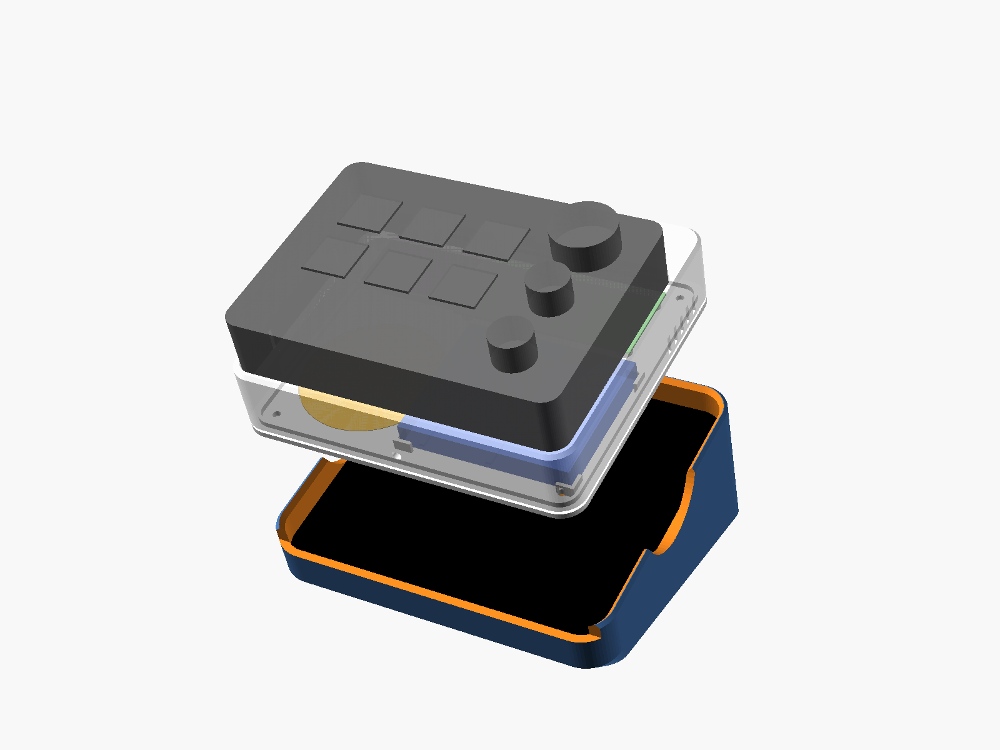

# HomeDeck remote case and wireless dock

A printable, parametric case that turns the Streonor S6 into a cordless Home Assistant remote, plus a tilted dock that charges it wirelessly. Everything is in one OpenSCAD file, [`homedeck.scad`](homedeck.scad).



| Part | File | Print |
| --- | --- | --- |
| Body (top shell, holds the S6) | `stl/body.stl` | PETG or PLA, upside down as exported, 0.2 mm, 3 walls, no supports |
| Lid (bottom plate and electronics sled) | `stl/lid.stl` | PETG or PLA, flat, 0.2 mm, no supports |
| Dock | `stl/dock.stl` | PLA, as exported, 15-20 % infill. Supports only for the coin pockets underneath, or bridge them |
| Dock pad | `stl/dock_pad.stl` | TPU 95A, 0.8 mm, 2 layers. Grippy, hides the coil and magnets |

> **The S6 dimensions are estimates.** I could not find published measurements for the Streonor S6 (or the Mirabox N3 / Ajazz AKP03 it is based on), so the defaults are placeholders. Measure the values below with calipers and set them at the top of `homedeck.scad` before printing anything. Printing the body costs about 4 hours, so a cheap first check is to print with `s6_grip_h = 3` and `bay_h = 3` as a fit ring.

## Measure before printing

| Parameter | What to measure | Default |
| --- | --- | --- |
| `s6_w` | S6 body width, left to right, at its widest | 116 |
| `s6_d` | S6 body depth, front to back, at its widest | 84 |
| `s6_corner_r` | Corner radius seen from above (a radius gauge, or match against coins) | 6 |
| `s6_usb_x` | USB-C port centre, offset from the centre line (+ is right, looking at the front) | 0 |
| `s6_usb_z` | USB-C port centre height above the S6's bottom surface, including its feet | 8 |
| `s6_h` | Overall height (only used for the preview) | 30 |
| `qi_rx_d`, `qi_rx_t` | Your Qi receiver coil diameter and thickness | 50.5, 2.0 |
| `qi_tx_d`, `qi_tx_t`, `tx_pcb` | Your Qi transmitter coil (with its ferrite) and its board | 52, 4.5, 32×32×6 |
| `bat_l`, `bat_w`, `bat_t` | Your LiPo pouch | 60, 50, 8 |
| `chg_l`, `chg_w` | Your charger board | 36.5, 23.5 |

The model assumes the S6's USB-C port is on its **back** edge. If it is on a side, tell me and I will add a side cable chamber. If the port sits higher than `s6_grip_h`, the plug window opens through the top rim as a slot. That still works, but raising `s6_grip_h` hides it.

`openscad` stops with an `assert` message if something no longer fits, such as a magnet landing on a screw hole or the battery being too thick for the bay.

## How it works

```
 Dock (USB-C 5 V 2 A)                          Remote
 ┌───────────────────┐   ~2 mm gap   ┌───────────────────────────────────────┐
 │ Qi TX board ─ coil│ ))))))))))))) │ coil ─ Qi RX ─▶ PowerBoost 1000C ─▶ 5 V │
 │ 4× magnets        │ ◀── snap ───▶ │ 4× magnets          │  ▲              │
 │ "dock" magnet ────│──────────────▶│ hall sensor ─▶ GPIO  │  LiPo          │
 └───────────────────┘               │                     ▼                 │
                                     │  Pi Zero 2 W ── USB OTG ── Streonor S6 │
                                     └───────────────────────────────────────┘
```

- **Remote.** The S6 drops into a pocket on top and is held by crush ribs. Push it out from underneath through the shelf opening. Its USB cable goes into a hidden chamber behind it, so nothing shows. Everything else mounts to the lid, so four M2.5 screws give you the whole electronics bay.
- **Charging.** A 5 V Qi receiver coil sits in a recess with 1 mm of plastic under it. It feeds a charger with load sharing (PowerBoost 1000C or similar), so the Pi keeps running while it charges. The charger's own USB port lines up with a slot in the left wall as a wired fallback.
- **Dock.** The cradle is tilted 18° toward you and has a chamfered lead-in, so you can drop the remote in without looking. Four magnet pairs pull it into exact coil alignment with a satisfying click. The transmitter coil and board sit under a TPU pad, and the cable leaves through a groove in the back. Two pockets underneath take 2 € coins or M12 washers as ballast so the dock does not lift with the remote.

## Parts list

| Item | Notes |
| --- | --- |
| Raspberry Pi Zero 2 W | Footprint and holes are parameters, so another Pi needs only new numbers and a taller `bay_h` |
| Streonor S6 | |
| LiPo pouch, 1S, ~805060 (2500-3000 mAh) | With a protection circuit. Bigger if `bay_h` allows, see battery life below |
| Adafruit PowerBoost 1000C, or another 1S charger + 5 V boost **with load sharing** | Cheap IP5306 boards cut power while switching to charging, which reboots the Pi |
| 5 V Qi receiver coil module (~50 mm) | |
| 5 V Qi transmitter module + 5 V 2 A USB-C supply | |
| 8× 6×2 mm and 1× 6×3 mm N52 disc magnets | 4 in the lid, 4 + 1 in the dock. Mind polarity: each remote/dock pair must attract |
| DRV5032 hall sensor breakout (optional) | 1.8 µA, open-drain to a GPIO with pull-up |
| 4× M2.5 heat-set inserts (3.5 mm OD, 4-6 mm long) + 4× M2.5×8 countersunk screws | |
| 4× M2.5 nylon screws or self-tappers | Pi standoffs |
| Mini slide switch (SS12D00 size) | On the PowerBoost EN pin |
| 3 mm clear PLA filament stub | Light pipe for the charge LED, front wall |
| Short right-angle USB-C to micro-USB OTG cable (or an FPC "ribbon" USB cable) | S6 to the Pi's data port |
| 4× 8 mm rubber feet | Dock underside |

## Battery life (estimate, please measure)

A Pi Zero 2 W idling with Wi-Fi on draws about 0.6-0.8 W. I could not find the S6's power draw; LCD-key decks of this size typically take 0.5-1.5 W with backlights on. At around 1.5-2 W total, a 3000 mAh cell (about 11 Wh, about 9 Wh usable after the boost converter) gives **roughly 4-6 hours off the dock**. That is fine if it lives on the dock and gets picked up, and not enough for a day away from it. A USB power meter between the Pi and the S6 will give a real number. The best software win is dimming the keys after 30 s without input and turning them back up on any key or knob, which OpenDeck's brightness setting can do. For longer life, increase `bay_h` by 10 mm and fit two 18650 cells (about 25 Wh).

## Assembly

1. Press the heat-set inserts into the four body bosses.
2. Glue the four remote magnets into the bottom of the lid (flush, from outside) and the dock magnets into the cradle floor, checking that every pair attracts. The extra 6×3 mm magnet goes under the hall sensor position in the dock.
3. Glue the Qi receiver coil into its recess on the inside of the lid, ferrite side up. Route its leads along the channel to the charger.
4. Mount the Pi on the standoffs, stick the battery inside its corner fence with foam tape, and put the charger in its fence with the USB port facing the left wall. Fit the hall sensor in its pocket.
5. Wire as in the diagram above. Pi power goes to header pin 2 (5 V) and pin 6 (GND), or the PWR micro-USB. Hall sensor output goes to GPIO 17 with the internal pull-up enabled. The PowerBoost LBO (low battery) pin can go to GPIO 27.
6. Plug the USB cable into the S6, set the S6 into the pocket, reach up through the bay to guide the plug into the chamber, then screw the lid on.
7. Dock: put the transmitter coil and board in their pockets, run the cable out of the back groove, and glue the TPU pad over the floor.

## Ideas beyond the brief

These are built into the model:

- **Magnetic self-alignment.** Qi efficiency falls off quickly with misalignment, so the magnets put the coils on top of each other every time, and the click tells you it is seated.
- **Dock sensing with a hall sensor.** A sixth magnet in the dock sits under a hall sensor in the remote. The Pi knows it is docked even if charging fails, and with a small script it can publish `binary_sensor.homedeck_docked` to Home Assistant. Ideas for using it: switch to a "bedside" page and dim the keys when docked, switch to a "room control" page when lifted, or announce "remote not docked" at night.
- **Tilted, weighted dock.** The 18° tilt makes the keys readable from a sofa or bedside, and the coin pockets stop the dock tipping or lifting.
- **Status light pipe.** The charger's LED shows through the front wall without another LED or GPIO.
- **Serviceable sled.** Everything mounts to the lid, so you can swap the battery or Pi with four screws.

These would need a little more hardware or code, and I can add any of them:

- **Battery level in Home Assistant.** A MAX17048 fuel gauge (I2C, 2 wires) gives a real percentage. Publish it as `sensor.homedeck_battery` and show it on a key.
- **Lift to wake.** A LIS3DH accelerometer (I2C, interrupt pin) brightens the keys when you pick the remote up and dims them when it is put down. It is the biggest single battery saver.
- **Room awareness.** With several docks, put a different hall magnet pattern (or an NFC tag) in each one, so docking in the bedroom loads the bedroom page automatically.
- **Pogo-pin variant.** Swap Qi for two pogo pins and a magnetic connector. Charging is faster and wastes less heat, at the cost of visible contacts. It is a small change to the model.
- **Haptic tick.** A small coin vibration motor on a GPIO gives feedback when a scene runs, so you know it worked without looking.

## Building the files

```sh
./build.sh            # writes stl/*.stl and images/*.png
openscad homedeck.scad   # open in the GUI; the Customizer panel shows every parameter
```

Pass overrides to every file on the command line, for example `./build.sh -D s6_w=118.2 -D s6_d=86`.
