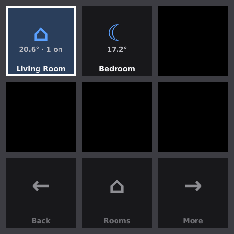
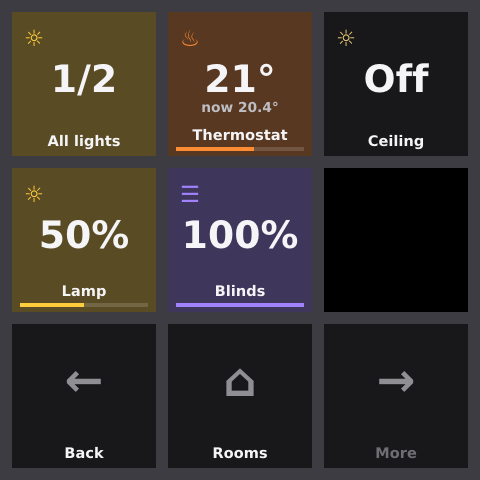
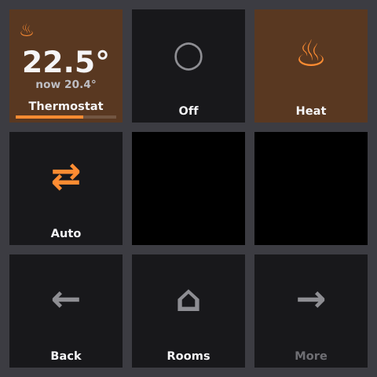
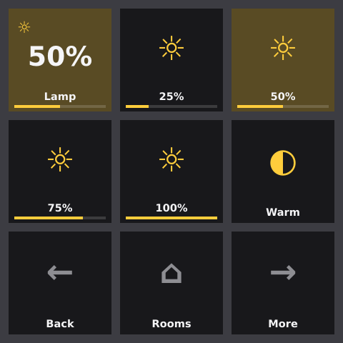

# Home Assistant Deck

An OpenDeck plugin that turns a stream deck into a Home Assistant remote. You connect it to Home Assistant once, and it builds the whole layout from your HA areas, devices and entities, sized to the deck you have (keys with screens, plain buttons, knobs). Nothing is configured key by key.

Made for the Streonor S6 on a Raspberry Pi, but it works on any deck OpenDeck supports.

| Rooms (big knob focuses) | Living Room | Thermostat, knob turning | Lamp (hold to open) |
| --- | --- | --- | --- |
|  |  |  |  |

The bottom row in these pictures is the S6's three plain buttons (no screens): Back, Rooms, More.

## How it works

The plugin provides one action, **Home Assistant Deck**. When it first sees a deck it creates a page called **Home Assistant** with that action on every key and knob and switches to it. From then on the plugin draws every key itself, which is what makes multi-step flows possible.

- **Rooms:** one key per HA area, ordered by floor and then name, showing temperature and how many lights are on. Areas with nothing to control are left out.
- **Room:** an "All lights" key (when the room has two or more lights), then thermostats, lights, covers, fans, media players, switches, locks, scenes and scripts. Tapping a key toggles it. Holding it opens the device. Tapping a thermostat or media player opens it straight away.
- **Device:** the main value on the first key, then shortcuts. Thermostats get their HVAC modes and presets, lights get 25/50/75/100% and warm/neutral/cool, covers get open/stop/close, fans get speeds, and media players get previous/play/next/mute.
- **Back to rooms:** after 30 seconds without input (you can change this), the deck goes back to the room list.

Values set with a knob show on the key straight away and are sent to HA once the knob stops turning, so HA isn't flooded with calls.

### Knobs

| Knob | Rooms | Room | Device |
| --- | --- | --- | --- |
| Main (S6: big top knob) | Move focus; press opens | Move focus; press opens or toggles | Main value (temperature, brightness, position, speed, volume); press toggles (a thermostat goes off and back to its last mode) |
| Second (S6: small left) | Change page | Brightness of all lights in the room; press toggles them | Thermostat: HVAC mode. Light: colour temperature. Media: source. Press: Back |
| Third (S6: small right) | Change page | Room thermostat temperature; press opens the thermostat | Thermostat: preset or fan mode. Light: hue. Media: previous/next track. Press: Rooms |

### Deck layouts

- **N3 family** (Streonor S6, Ajazz AKP03, Mirabox N3, Soomfon SE, …): the 6 screen keys show content, the 3 plain buttons are Back, Rooms and More, and there are 3 knobs.
- **Other decks:** every key shows content. Away from the room list, the last key is Back (hold it for Rooms), and a More key appears when there are more items than keys.
- The knob count comes from the deck's existing pages. If you put the action on only some keys of a page, only those keys are used.

## Setup

1. Install the zip from the releases in OpenDeck (Plugins → Install from file).
2. Open the new **Home Assistant** page (or place the action on any key) and click a key to open its settings.
3. Enter your HA URL (for example `http://homeassistant.local:8123`) and a long-lived access token (HA profile → Security → Long-lived access tokens).

The settings are the plugin's OpenDeck global settings:

```json
{ "url": "http://homeassistant.local:8123", "token": "…", "timeoutSecs": 30, "holdSecs": 0.5, "autoPage": true, "hiddenAreas": [], "hiddenEntities": [] }
```

Anything that can set a plugin's global settings, such as the mobile config app through the OpenDeck fork's remote API, can configure the plugin. Changes apply live.

If the OpenDeck fork's remote API is running (the plugin reads the token from `<config>/remote.json` and checks `GET /api/info`), the page is created through it. Otherwise the profile file is written to `<config>/profiles/<device>/Home Assistant.json`. OpenDeck loads a new profile the first time it is selected, so no restart is needed. A page you delete is not created again; use "Create Home Assistant page" in the settings to bring it back.

## Development

```sh
cargo test                                   # UI flows, layouts, HA model
cargo run -- --preview /tmp/preview          # draw the demo home's screens as PNGs
python3 tests/mock_ha.py 18123 &             # stand-in Home Assistant (token: test-token)
cargo run -- --check http://127.0.0.1:18123 test-token light.living_room_lamp toggle
cargo build && MOCK_LOG=mock.log python3 tests/fake_opendeck.py target/debug/opendeck-homeassistant 18123
scripts/package.sh                           # dist/opendeck-homeassistant.zip
```

`fake_opendeck.py` plays OpenDeck's side of the plugin protocol for an S6. It checks that the page gets created and drawn, then runs pick room → thermostat → three knob clicks (21° → 22.5°) → timeout back to rooms against the mock HA.

Known limits: thermostats with only a low/high range (no single target) can't be adjusted with the knob yet, and the S6's knobs have no screens, so nothing is drawn for them.
